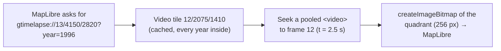

"Google Earth Timelapse annual" is one of the global catalogs on the [historical timeline](/features/historical-sources#mapping-agencies-national-catalogs): one cloud-free mosaic of the whole land surface for every year from 1984 to 2022, under the **Medium res** pill next to Landsat WELD. This page covers where the tiles come from, how the `gtimelapse://` protocol reads them, and what Google's own methodology says the mosaics are and are not.

## The dataset

In October 2026 Google released the mosaics behind its [Timelapse viewer](https://earthengine.google.com/timelapse/) as open data in the Earth Engine Data Catalog: [`projects/ee-earth-timelapse/assets/annual`](https://developers.google.com/earth-engine/datasets/catalog/projects_ee-earth-timelapse_assets_annual), an image collection of 39 annual RGB mosaics, 8-bit, under CC BY 4.0 with the credit "Google Earth Timelapse (Google, Landsat, Copernicus)". Two eras, both gridded in Web Mercator:

| Years | Sensors | Pixel |
|---|---|---|
| 1984 to 2014 | Landsat 4, 5, 7 and 8 | 30 m |
| 2015 to 2022 | Sentinel-2A and 2B, fused with Landsat 8 and 9 | about 19 m |

No other open series offers a yearly, cloud-free, global mosaic at this resolution before 2015: NASA's Landsat WELD on GIBS stops at three epochs (1984-85, 1989-90, 1999-2000), HLS starts in 2013, EOX's Sentinel-2 cloudless in 2016. The Earth Engine asset, though, only serves tiles to a signed-in Earth Engine project, which the app cannot be.

The on-the-fly alternative is the **Landsat 1982+** pill (`lib/pc-landsat.ts`): Microsoft Planetary Computer's mosaic API tiles any Landsat Collection 2 search without a token, so a quarter of any year since 1982 can be drawn from the least cloudy scenes, with their seams and residual cloud. Timelapse is the clean yearly frame, Planetary Computer the raw archive at any season; both sit under the Medium res pill.

## Where the tiles come from

The viewer reads its own tiles from a public Cloud Storage bucket with an open CORS header:

```
https://storage.googleapis.com/earthengine-timelapse/2023/earth/20230206/{z}/{x}/{y}.webm
```

Each tile is a VP9 WebM video, 512 px square, five frames a second, 39 frames: frame 0 is 1984, frame 38 is 2022. Zooms 0 to 12 exist; a zoom-12 frame is about 19 m a pixel at the equator, the native resolution. A tile over a coast at zoom 5 is near a megabyte, an inland tile at zoom 12 a few hundred kilobytes, every year included.

The bucket layout is the viewer's own, with a dated build folder, not a documented endpoint; it may move without notice, and the dataset's licence is the one to cite.

## The protocol

```
gtimelapse://{z}/{x}/{y}?year=YYYY
```

A year is a frame, so the protocol (`lib/google-timelapse.ts`) decodes video rather than fetching images:



- **256 px tiles from 512 px frames.** Every raster basemap here is declared with 256 px tiles, so a tile at zoom z is one quadrant of the frame at zoom z - 1: the source's maxzoom is 13 with the finest video at 12, the zoom-0 tile is the zoom-0 frame halved, and deeper requests read the matching sub-square of the zoom-12 frame.
- **One fetch per tile, every year.** Videos are cached by tile in a byte-bounded map (192 MB, a few hundred tiles). Changing the year on the timeline re-seeks the cached videos and fetches nothing; the [tile result cache](/dev/tile-caches) in front of the protocol keeps the finished bitmaps of recent years as well.
- **Seeking, not demuxing.** A page has no WebM demuxer, so three detached video elements take turns: load the tile's blob, set `currentTime` to the middle of the frame, wait for `seeked`, and `createImageBitmap` the frame's quadrant. A seek within a loaded video takes milliseconds; the first tile of a screen waits for the download.
- **Through the registry.** Registered with `registerProtocol` like the others, so the Export Multi mosaic and every other consumer reach it.

In the catalog (`lib/national-historical.ts`), the source is marked `complete`: every layer covers every point, so the timeline lists all 39 years without probing a tile at the view's centre as it does for regional series.

## How Google builds a year

From the [methodology](https://developers.google.com/earth-engine/timelapse/about), what matters when reading the mosaics:

- **Scenes and seasons.** Between 57°S and 60°N the whole year is used; above 60°N only days 150 to 270, peak growing season, to avoid snow and low sun; the Antarctic coast takes austral summer plus a multi-year baseline.
- **Clouds.** Landsat pixels are scored with `simpleCloudScore`, with a threshold adapted per scene and raised over bright surfaces such as dunes and salt flats; Sentinel-2 uses Cloud Score+.
- **Normalisation.** Top-of-atmosphere reflectance is scaled to 8 bits (0.02 to 0.50, gamma 1.7), haze and scene-to-scene differences are removed against MODIS BRDF-adjusted composites, Landsat 7, 8 and 9 are pansharpened from their 15 m band, and the year is reduced with a median.
- **Gaps.** Before 1999, where a year has no cloud-free observation, each pixel is interpolated linearly between the nearest valid years before and after, then real observations are laid on top. A reservoir filled or a forest cleared inside such a gap therefore appears as a gradual transition, not an event.
- **Water.** Land and water are separated with Hansen's Global Forest Change mask and MODIS MOD44W; the ocean is drawn as a shaded NOAA ETOPO1 bathymetry in blue, inland lakes keep their colour.

The result is made for the eye: colour-balanced, sharpened, consistent from year to year. The red, green and blue values are not radiometric measurements, and the 2015 switch to Sentinel-2 changes the pixel size mid-series.

## What it is good for here

A tick per year everywhere on the globe, so a place with no regional archive still has a 39-year series; the [change comparison](/features/split-modes) of two years in a split; a yearly context under the sparse very-high-resolution ticks of [Google Earth Historical](/dev/ge-historical), whose own low-zoom Landsat mosaics stop where its archive does.
