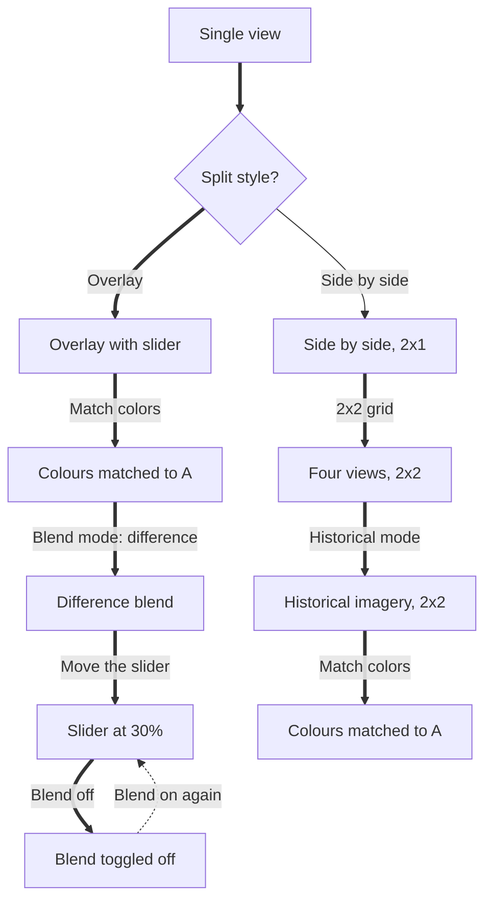

# F1 · Compare two terrain sources

Intro: A reviewer adds a second terrain source and chooses how to compare the two: as an overlay with a slider, matched colours and a blend mode, or as side-by-side views that can grow to a 2×2 grid and switch to historical imagery.

Notes: Node ids in the diagram are screen ids from screens.json. `==>` is the main route, `-->` an alternative, `-.->` optional or a way back. `{ }` nodes are decisions and have no screenshot.

