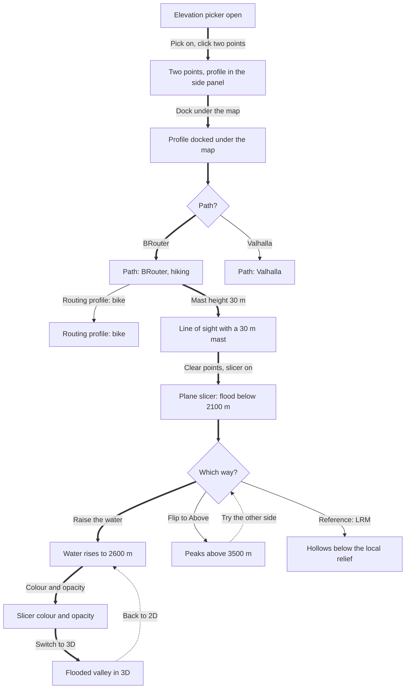

# F3 · Elevation picker: points, profile, routes and the slicer

Intro: A reviewer opens the Elevation Picker over Zermatt, picks two points and reads their profile in the side panel, docks the profile under the map, routes the path with BRouter or Valhalla and changes the routing profile, checks the line of sight with a mast, then clears the points and plays with the plane slicer.

Notes: Picks, docking and routing are app actions, not URL state. Those screens are captured by agent-browser replaying the clicks listed in screens.json, so they are Observed like the others.

